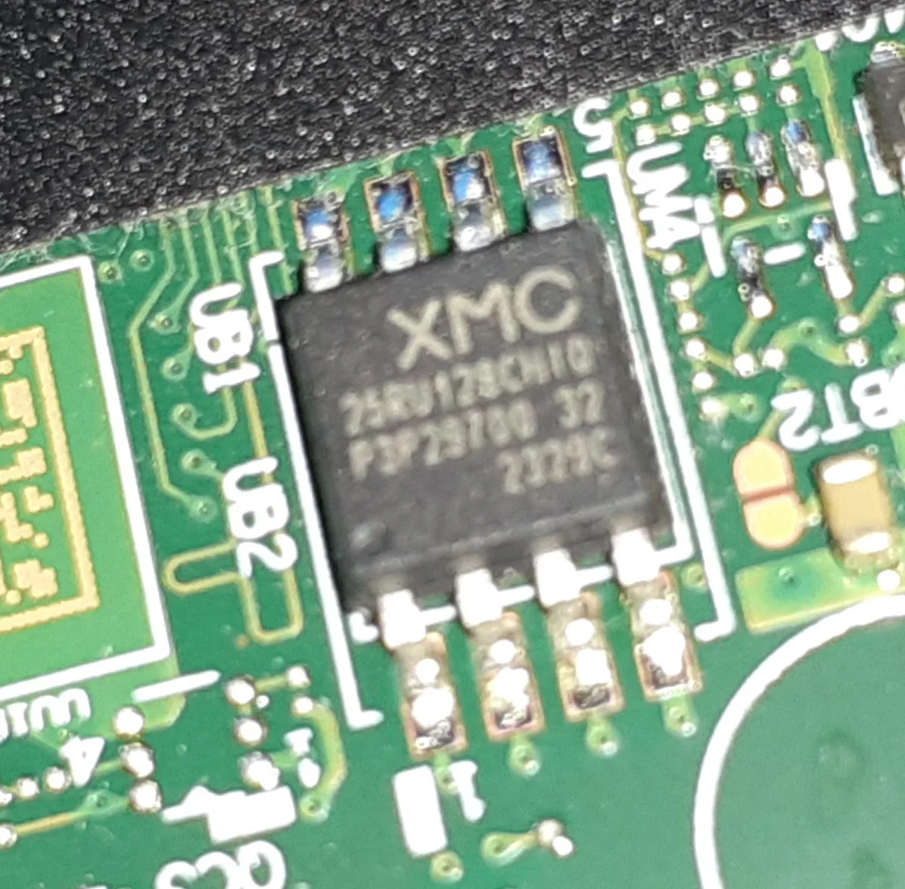
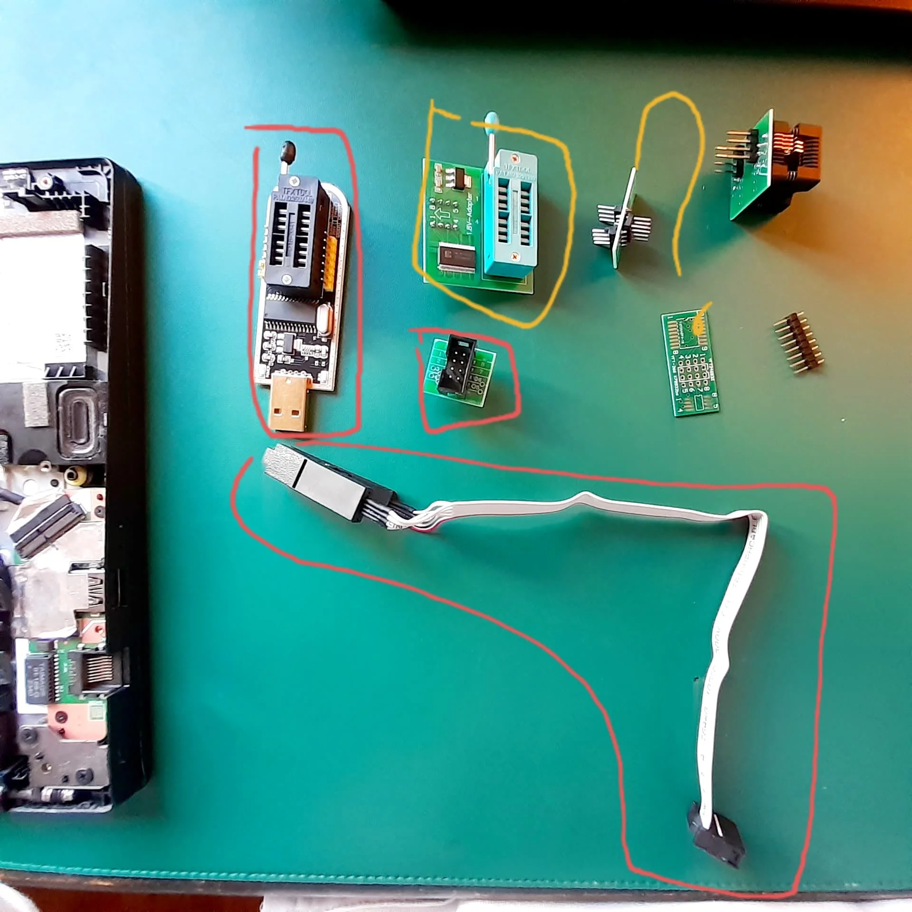
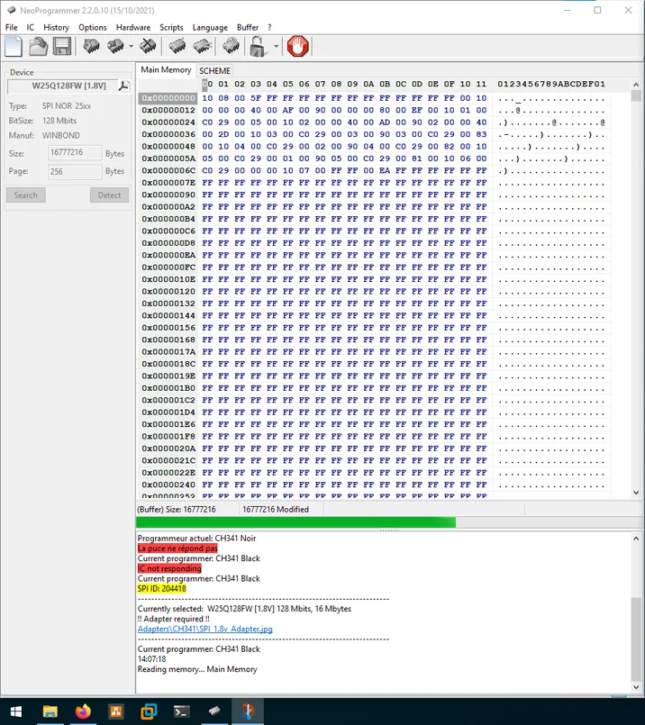

## Contexte

Un jour, en septembre 2025, j'ai voulu installer une autre distribution Linux sur le [Lenovo](https://pcsupport.lenovo.com/fr/fr/products/laptops-and-netbooks/lenovo-v-series-laptops/lenovo-v14-g4-amn) que la Région Grand Est m'avait donné l'année précédente, lors de mon entrée en seconde.

Je n'arrive pas à démarrer sur ma clé USB. Pas de panique, j'entre dans le BIOS pour réactiver le démarrage depuis des périphériques USB.

Et là, je me rends compte que j'ai oublié mon mot de passe… c'est malin.

Je commence à marchander avec le fournisseur de la Région, qui ne veut évidemment rien savoir. Il n'a pas tort, c'est moi qui me suis enfermé dehors comme un gros \*\*\*...

Je cherche sur le web, je demande à ChatGPT (pas aussi "intelligent" qu'aujourd'hui, si vous vous en souvenez)… Ça commence à parler de choses que je n'ai jamais vues. Je panique, et je reste coincé quelque temps sur la distribution que j'avais installée.

## Comment j'ai résolu mon problème

Après moult recherches, j'achète du matériel sur AliExpress : un programmateur CH341B, une pince crocodile adaptée à la puce de BIOS XMC, et un convertisseur 1,8 V, car la puce tourne en 1,8 V, et le CH341 envoie du 3,3 V. Rien d'extraordinaire.

Je ressors une vieille tour Windows 10 du placard et j'ouvre le portable. Je pose la pince sur la puce (dans le bon sens, le point marque la broche 1) et je lance NeoProgrammer, en suivant un tuto YouTube. Au fait, je déteste YouTube.

NeoProgrammer ne connaît pas ma puce, mais la **W25Q128FW** de Winbond fait parfaitement l'affaire : même taille, même tension. Je fais un dump, je le sauvegarde. Reste à trouver quoi écrire à la place.

### Le plan A

J'essaie d'abord d'extraire le bios propre du .exe proposé par Lenovo, pour la M à J. Mauvaise idée : c'est une capsule pleine d'en-têtes, pas une image qu'on écrit telle quelle sur la puce. J'oublie

### Le plan B (le bon)

**Le lendemain, je constate qu'il y a plein de PC identiques au ien au lycée. On accepte de m'en prêter un, dont le BIOS est sain et sans mot de passe configuré ni autre histoire.**

**Je fais un dump du PC sain, puis j'écris ce dump sur la puce de mon portable. C'est tout.**

Premier démarrage, j'appuie sur F2 et j'ai droit à un message ouin-ouin du PSP (le processeur de sécurité d'AMD) : la NVRAM n'est pas saine, Y : erase, N keep. Après vérification ça ne concerne que les sado-masochistes qui utilisent Windows et Bitlocker.

Problème résolu.

## Liens

[Page de support de Lenovo pour le V14 G4 AMN](https://pcsupport.lenovo.com/fr/fr/products/laptops-and-netbooks/lenovo-v-series-laptops/lenovo-v14-g4-amn/downloads/driver-list/component?name=BIOS&id=5AC6A815-321D-440E-8833-B07A93E0428C)

[Lien directe (version disponible au 13 novembre 2026)](https://download.lenovo.com/consumer/mobiles/l1cn74ww.exe)

[Conversation avec CrouicGPT](https://chatgpt.com/s/dr_68d82033df3081919fcc887fdaf689a0)
